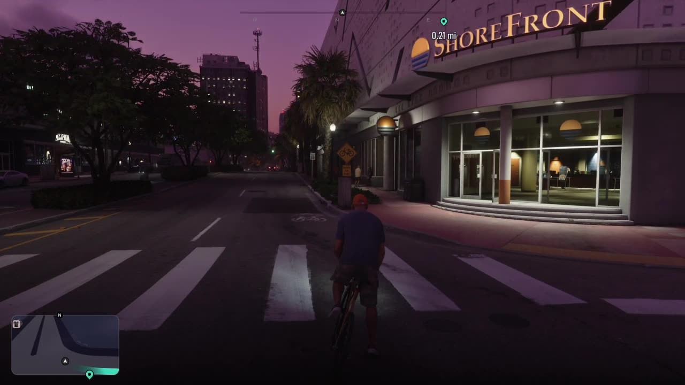
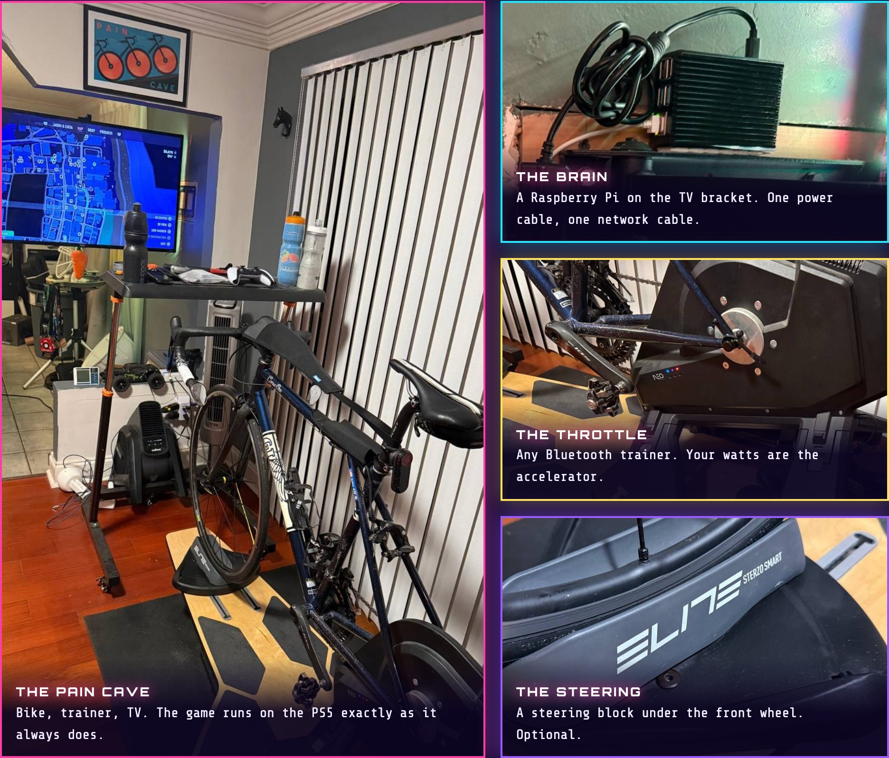
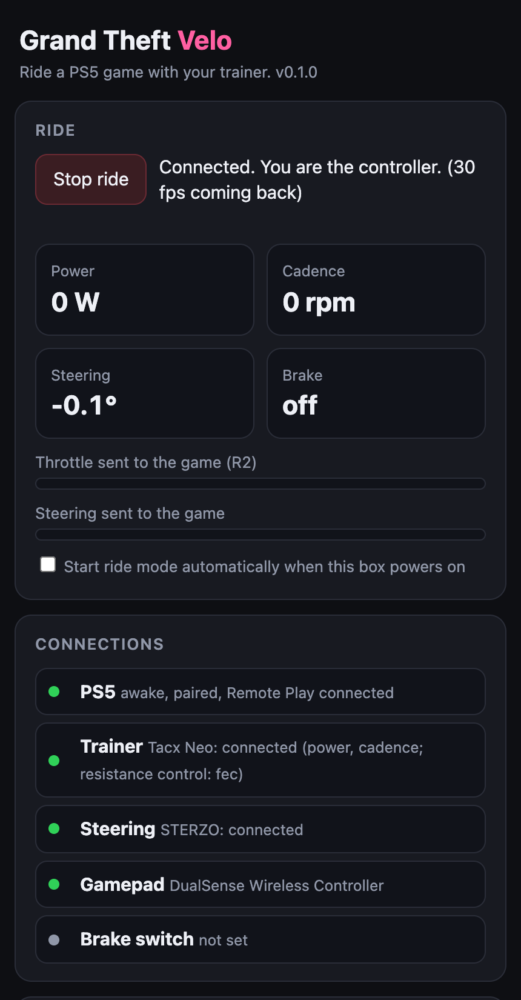
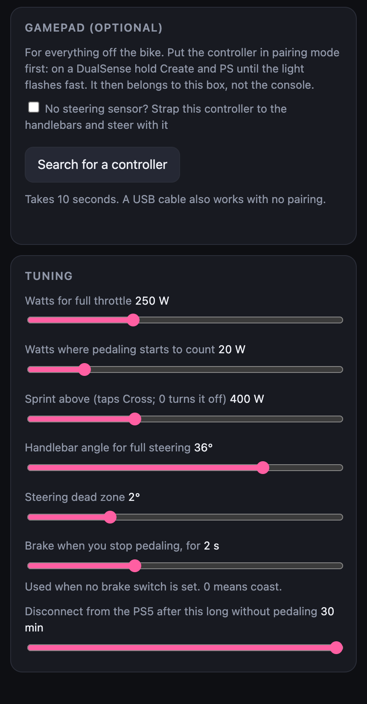

<h1 align="center">Grand Theft Velo</h1>

<p align="center"><strong>Ride GTA 6 on a real bike.</strong><br>
Pedal harder and the bike in the game goes faster. Turn your handlebars and it turns. Your legs are R2.</p>

<p align="center">
  <a href="https://grandtheftvelo.com">Website</a> ·
  <a href="#install">Install</a> ·
  <a href="#where-it-is-today">Status</a> ·
  <a href="#roadmap">Roadmap</a> ·
  <a href="#questions">Questions</a> ·
  <a href="https://github.com/blackandwhitehat/grand-theft-velo/issues">Report a result</a> ·
  <a href="https://donate.stripe.com/bJe9AU1I5bJw6LWfB5eIw00">Donate</a>
</p>

<p align="center">
  <a href="LICENSE"></a>
  <picture></picture>
  <picture></picture>
  <picture></picture>
</p>

A Raspberry Pi sits at your trainer, reads your power over Bluetooth and plays the part of the controller
through PS5 Remote Play. The PS5 stays on the TV, so you ride watching the normal picture at full quality.
Nothing is modified on the console, nothing is plugged into it, and the game does not know the difference.

<!-- RIDE VIDEO GOES HERE -->

<p align="center">
  <picture></picture>
</p>
<p align="center"><em>Captured mid-ride. Every foot of that street was pedaled on the bike below.</em></p>

<p align="center">
  <picture></picture>
</p>
<p align="center"><em>The whole setup. No lab, no rack of gear: a bike on a trainer in front of the TV, and a Raspberry Pi hidden behind it.</em></p>

## It is this simple

If you already own a PS5 and an indoor trainer, the only thing you need is a Raspberry Pi.

1. **Run one command** on the Pi. It installs everything by itself in about 15 minutes.
2. **Open the page it gives you** on your phone and tap through setup: pick your console, pick your trainer.
3. **Press Start ride and pedal.**

No gaming PC. No mod. No soldering. No capture card. Nothing plugged into the console, and nothing changed on
it. No account to create with us and nothing sent to us. If you do not like it, press Stop ride and your
trainer and your PS5 are exactly as they were.

You do not need the steering block or a brake to start. A trainer and the controller you already have are
enough for a first ride: your legs do the throttle, the controller steers (by thumb, or strapped to the bars
so the bars steer), and the bike brakes by itself when you stop pedaling.

## Why this one is different

When we looked at what already existed, the bike projects for GTA 5 (GT Bike V is the best known) all worked
the same way: a mod loaded into the PC version of the game. That needs a gaming PC, a modded copy of the game,
and a mod that keeps up with every game update. It also cannot work on a console at all.

Grand Theft Velo takes the other road:

- **No mod.** The game is untouched, on a stock PS5. To the console, the Pi is just a Remote Play controller.
- **The real console picture.** You watch the PS5 on your TV as normal, at its native resolution and frame
  rate. The Remote Play video only goes to the Pi; you never look at it.
- **No video lag.** Because the picture comes straight from the console to the TV, there is no streaming
  delay or compression in what you see. Only your inputs travel over the network.
- **Nothing to break on update day.** There is no mod to fall out of step with a game patch.

It is built for the bicycle in GTA 6, the only game it has been tested in. More games may be supported in the
future.

## The goal: your ride, on the map

Riding the game is the start. The goal is that a ride through Vice City counts like a ride outside:

- **Your route, drawn on the game's map.** Where you went, street by street, read from the game's own map
  while you ride.
- **Real numbers.** Distance, speed, time, power, cadence and heart rate, in one ride file.
- **On Strava when you stop.** Uploaded by itself, with the route as its map, the way Zwift rides show up.
- **Only what you pedaled.** A tracked ride logs only while your character is on a bicycle. Steal a car and
  the log pauses until you are back on a bike.
- **Or make the whole game the workout.** A second mode, pedal to play, drops the map and logs effort only. You
  can do anything in the game with the controller, but you have to keep pedaling the entire time. Stop, and
  the game pauses on you.
- **Hills you can feel.** The trainer gets harder when the road in the game climbs.

Almost none of that is built yet. Today it turns your pedaling and steering into the game's controls, and that part
works. The [roadmap](#roadmap) has the plan and what we know so far.

<p align="center">
  <picture></picture>
  &nbsp;
  <picture></picture>
</p>
<p align="center"><em>Everything is set up and tuned from a page on your phone.</em></p>

<details>
<summary><strong>Contents</strong></summary>

- [It is this simple](#it-is-this-simple)
- [Why this one is different](#why-this-one-is-different)
- [The goal: your ride, on the map](#the-goal-your-ride-on-the-map)
- [Where it is today](#where-it-is-today)
- [What you need](#what-you-need)
- [Install](#install)
- [Set up](#set-up-once-in-the-web-page)
- [Ride](#ride)
- [Roadmap](#roadmap)
- [Questions](#questions)
- [If something is wrong](#if-something-is-wrong)
- [How it works](#how-it-works)
- [Things to know](#things-to-know)
- [Support the project](#support-the-project)
- [License](#license)
- [Who made this](#who-made-this)

</details>

## Where it is today

This is an early project that works on its author's bike. Read this section before you buy anything.

**Working now, on real hardware:**

- One command installs everything on a Pi, with a web page for all setup. No config files to edit.
- Connects to the PS5 over Remote Play and holds the session while you ride.
- Reads power and cadence from a Bluetooth trainer and turns power into R2, from a light squeeze to full.
- Reads steering from an Elite Sterzo Smart.
- Your controller pairs to the Pi from the web page and stays fully usable: every button, both sticks,
  triggers and the touchpad pass straight through to the console while you ride.
- Every number (watts for full throttle, steering lock, sprint line) is a slider on the page.

**Tested on exactly one setup:** PS5 (system 14.23), Raspberry Pi 4 (4 GB, Raspberry Pi OS Lite 64-bit),
original Tacx Neo, Elite Sterzo Smart, DualSense.

**Written but not proven yet:**

- Two controllers at once (one on the handlebars as the steering sensor, one in your hands).
- Steering with the controller itself: strap a DualSense or DualShock 4 to the handlebars and its motion
  sensors read the bar angle, so no steering block is needed. Checked on a real controller at rest (it holds
  zero without drifting); not yet ridden.
- Braking by stopping: with no brake switch, the bike brakes for two seconds when you stop pedaling. It works
  in a simulated run; it has not been tuned on a real ride yet.
- Riding with only a cadence sensor instead of a power source.
- How it feels on the bicycle in GTA 6: whether the game treats a half-pressed R2 as half speed, and whether
  the sprint (Cross tapped for you above a power line) behaves. The first real rides are happening now.
- Pairing a console from the web page. The author's console was paired with another tool and imported.
- Trainers that speak FTMS instead of Cycling Power (most Wahoo, Zwift Hub, JetBlack and newer units). The
  code is there and has unit tests. Nobody has ridden it.
- Waking the PS5 from rest mode when you press Start ride.
- The brake switch.
- Setting trainer resistance.

- Ride log and heart rate. Every ride is saved (time, power, cadence, heart rate from any Bluetooth strap)
  and can be downloaded as a file that Strava, Garmin Connect and intervals.icu accept. Distance in that file
  is an estimate from your power on a flat road, not what the game shows. Tested with made-up data, not yet
  with a real ride or a real strap.

**Not built yet:** automatic Strava upload, route tracking, the two ride modes, hills. See the roadmap below.

If you have a different trainer and try it, open an issue with what happened. That is the most useful thing
anyone can do for this project right now.

## What you need

| | What | Notes |
|---|---|---|
| Required | A PS5 on your home network | Remote Play turned on, and a PlayStation account signed in on it |
| Required | Raspberry Pi 4 or 5 | Or any 64-bit Debian machine with Bluetooth. Network cable strongly recommended |
| Required | A Bluetooth trainer or sensor | Smart trainer, power meter, or as a minimum a cadence sensor |
| Optional | Elite Sterzo Smart | For steering. Without it, strap the controller to the bars and steer with that, or use its stick |
| Optional | A controller for the Pi | DualSense, DualShock 4, Xbox and most others, by Bluetooth or USB |
| Optional | A brake switch | Any two-wire switch on a GPIO pin, such as a stick-on e-bike brake sensor |

### Your controller still works, all of it

You keep playing with a normal controller. You pair it to the Pi from the web page (hold Create and PS until
the light double-flashes, press Search, press Pair), or plug it into the Pi by USB. From then on every button,
both sticks, the triggers and the touchpad click go through the Pi to the console, exactly as if it were
connected directly. The bike adds to it: your legs press R2 and your bars move the left stick, and you can
still do either by hand at any moment. Getting off the bike, shooting, the phone, the map, menus: all on the
controller, as normal.

Why it pairs to the Pi and not the PS5: a controller that is signed in on the console itself ends the Remote
Play session. Pairing it to the Pi takes it away from the console until you pair it back.

**Two controllers work too.** Pair a second one and both are read at once. Strap one to the handlebars as the
steering sensor and keep the other in your hands, or leave it on a shelf within reach. On the page you pick
which one is on the bars. This is written and the one-controller path is ridden; nobody has tried two yet.

About the trainer: it needs a free Bluetooth connection. Many trainers allow only one, so close Zwift and
similar apps first. ANT+ is separate, so a bike computer can still record the ride over ANT+ at the same time.

## Install

On the Pi, with Raspberry Pi OS (64-bit):

```
curl -fsSL https://grandtheftvelo.com/install.sh | bash
```

That one line downloads the project, installs what it needs, builds the Remote Play library and starts the
service. It takes about 10 to 15 minutes on a Pi 4. When it finishes it prints an address. Open it on your
phone: `http://<the Pi>:8080/`. Run the same line again later to update.

Prefer to see what you are running first? It is the same thing by hand:

```
git clone https://github.com/blackandwhitehat/grand-theft-velo.git
cd grand-theft-velo
./install.sh
```

The install has been tested from a completely bare 64-bit Debian 13 system on a Pi 4: packages, build and
tests all pass with nothing preinstalled. It has not yet been run on a freshly flashed SD card by anyone but
the author, so if it trips on yours, please open an issue with the last lines it printed.

## Set up (once, in the web page)

1. **PS5.** Follow the four steps on the page: turn on Remote Play on the console, pick the console, sign in
   to PlayStation once, type the 8-digit Link Device code.
2. **Bike sensors.** Pedal to wake the trainer, press Search, choose your trainer and your Sterzo if you
   have one.
3. **Gamepad (optional).** Hold Create and PS until the light double-flashes, then pair it from the page. Or
   plug it in by USB.

## Ride

Start the game on the PS5, get on a bicycle in the game, and press **Start ride** on the page. Pedal.

| On the bike | In the game |
|---|---|
| Pedaling power | R2, from light to full (full at 250 W by default) |
| Handlebar angle (Sterzo, or a controller strapped to the bars) | Left stick left and right (full lock at 30 degrees by default) |
| Brake switch | L2 |
| No brake switch: stop pedaling | L2 for two seconds, then released (set it to 0 to coast instead) |
| Power above the sprint line (400 W by default) | Cross, tapped |
| Gamepad | Everything else, passed straight through |

Press **Stop ride** when you are done. With ride mode off the Pi never touches the console, so the trainer is
free for other apps.

## Roadmap

The goal is a ride you can log like any other: time, power, heart rate, distance and the route you rode
through the game world, uploaded to Strava when you stop. Only the first step has been started. Here is the
plan, in the order it will be built.

**1. Ride file and heart rate.** The recording and the download are written (see above). Still to do: connect
Strava once and have every ride upload by itself.

**2. Route tracking.** The Pi already receives the game's video, so the plan is to read your position from
the screen, the same way you would:

- **Heading** from the minimap. It always faces the way you face, and a north marker rides around its rim, so
  the compass direction can be read on every frame.
- **Position** from the full map. It shows your marker exactly, so opening it for a moment at the start and
  end of a ride pins the route to real places on the map and corrects any drift in between.
- **Distance and speed** from the two together, checked against how fast you are really pedaling.
- **The Strava map.** Strava needs coordinates on Earth, and the game world is not on Earth. Zwift solves this
  by pinning its worlds onto a real spot, and the plan is the same: the game map gets a fixed home, so every
  ride draws as a true shape of the streets you rode.

**3. Two ways to ride.** You will choose one:

- **Tracked ride.** The ride is logged with its route on the map, and only while your character is on a
  bicycle. Step off the bike in the game and the log pauses. Get back on and it resumes. What ends up on
  Strava is honest: every mile in the file was pedaled by your character and by you.
- **Pedal to play.** No map and no route: the ride file is effort only (time, power, cadence, heart rate). In
  exchange you can do anything in the game, on foot or in a car, with the controller. The catch: you have to
  pedal the whole time. Stop, and the game pauses until your legs start again. The whole game becomes the
  workout.

**4. Hills.** Make the trainer harder when the road in the game goes up. The game shows no elevation while you
are on the ground, so this is the hardest part and may come from reading the picture or from a height map of
the world. Road feel on trainers that support it is in the same bucket.

What we know so far from looking at the game: the minimap is tilted and see-through in vehicles, which makes
measuring distance from it alone unreliable, so the full map will be used to pin the route down. Telling
whether the character is on a bicycle has to be read from the screen as well, and that has not been worked
out yet.

## Questions

<details>
<summary><strong>Will this get my PlayStation account banned?</strong></summary>

It uses the same Remote Play feature as Sony's own phone and
PC apps and sends ordinary controller input. Nothing on the console is modified. That said, it is an
unofficial client, and nobody can promise what Sony will do. Use it at your own risk.

</details>

<details>
<summary><strong>Do I need a smart trainer?</strong></summary>

No. Anything that reports power or cadence over standard Bluetooth works: a
smart trainer, a power meter on a dumb trainer, or a cadence sensor alone. With only cadence, speed in the
game follows how fast you spin, not how hard you push.

</details>

<details>
<summary><strong>Do I need the Sterzo?</strong></summary>

No. Strap a DualSense or DualShock 4 to your handlebars, tick the box on the page, and its motion sensors
become the steering sensor. Or just steer with the left stick.

</details>

<details>
<summary><strong>Does it work with other games?</strong></summary>

Not at the moment. It is built for and tested in GTA 6 only. More games may be supported in the future.

</details>

<details>
<summary><strong>Does it work on a PS4, Xbox or PC?</strong></summary>

Not today. The Remote Play library underneath also speaks to a PS4, so
that is possible later. Xbox and PC are future possibilities.

</details>

<details>
<summary><strong>Can I still use Zwift?</strong></summary>

Yes, just not at the same moment. Press Stop ride and the trainer is released.

</details>

<details>
<summary><strong>How much lag is there?</strong></summary>

None you can feel with the Pi and the PS5 on network cables. Only your inputs travel over the network, and
you watch the TV directly, so there is no video delay at all. On Wi-Fi it depends on your Wi-Fi.

</details>

<details>
<summary><strong>Can two people ride?</strong></summary>

One bike per console.

</details>

## If something is wrong

- **The trainer does not show up in Search.** Pedal first to wake it, and close any app or bike computer that
  is connected to it by Bluetooth.
- **The controller pairs but nothing happens.** Take it out of the list and pair again from the page with the
  light double-flashing. It has to be in pairing mode, not just switched on.
- **Start ride says the PS5 is not answering.** Turn the console on by hand once, and check the address on the
  setup page. Automatic search only works when the Pi and the console are on the same network segment.
- **The session keeps ending.** A controller signed in on the console itself takes over. Pair it to the Pi.
- **Nothing happens when you pedal.** Look at the Ride card: if Power shows your watts but the throttle bar
  stays empty, lower "Watts where pedaling starts to count" under Tuning.

For anything else, the Log at the bottom of the page says what the Pi is doing, and `journalctl -u gtv -f`
on the Pi says more. Open an issue with those lines.

## How it works

```
 trainer (power, cadence) ─┐
 Sterzo (steering)        ─┤                      ┌─► controller state ─► PS5 ─► game
 brake switch (GPIO)      ─┼─► gtv (Python) ─UDP─► bridge (C, chiaki-ng)
 gamepad (evdev)          ─┘        ▲                └◄─ video, rumble, trigger effects
                                 web page
```

- `gtv/` is the service: web page, Bluetooth (`ble.py`), gamepad (`gamepad.py`), console pairing (`ps5.py`).
- `native/bridge.c` merges bike and gamepad into one controller and holds the Remote Play session.
  `native/register.c` pairs with the console. Both use [chiaki-ng](https://github.com/streetpea/chiaki-ng)'s
  library, which is fetched by the installer, not copied here.
- Settings and the console pairing live in `~/.config/gtv/config.json`, readable only by you.

Useful commands: `systemctl status gtv`, `journalctl -u gtv -f`, `python3 -m unittest discover -s tests -t .`

## Things to know

- The web page has no login by default. Keep it on your home network, or set `GTV_PASSWORD` in
  `/etc/systemd/system/gtv.service` (`Environment=GTV_PASSWORD=...`) to require one.
- When a session ends the game shows "Controller disconnected". That is the bridge leaving, nothing more.
- The console refuses a reconnect for about ten seconds after a session ends.
- If the PS5 is on a different network segment from the Pi, automatic discovery will not find it; type its
  address on the setup page.
- Raise the PS5's rest-mode timer for long rides (Settings, System, Power Saving).
- This uses the same Remote Play protocol as Sony's own apps and sends nothing but ordinary controller input.
  It is not affiliated with or endorsed by Sony, Rockstar Games or Take-Two.

## Support the project

Grand Theft Velo is free and open source, built in spare hours on one bike. Donations go to hardware for
testing (other trainers, steering devices and consoles), so it works on your setup and not just one.

**[Donate through Stripe](https://donate.stripe.com/bJe9AU1I5bJw6LWfB5eIw00)**: any amount. Donations go to Bamboo Labs LLC and are not tax deductible.

The other way to help costs nothing: ride it, break it, and
[tell us what happened](https://github.com/blackandwhitehat/grand-theft-velo/issues).

## License

[GNU Affero General Public License v3.0](LICENSE). The Remote Play library this builds on,
[chiaki-ng](https://github.com/streetpea/chiaki-ng), is under the same license. You can use, change and share
this freely; if you share a changed version, or run one as a service for others, you share your source too.

## Who made this

<a href="https://bamboolabsllc.com"></a>

Built by Panda, who wanted to ride a bike through Vice City instead of around another virtual volcano.

- [Bamboo Labs](https://bamboolabsllc.com)
- [BambooSec](https://bamboosec.com)

Writing about it or sharing it? The [press kit](press/) has images and a slide deck.

<br clear="left">

Not affiliated with or endorsed by Sony, Rockstar Games, Take-Two, Garmin, Elite or Strava. All trademarks
belong to their owners.
